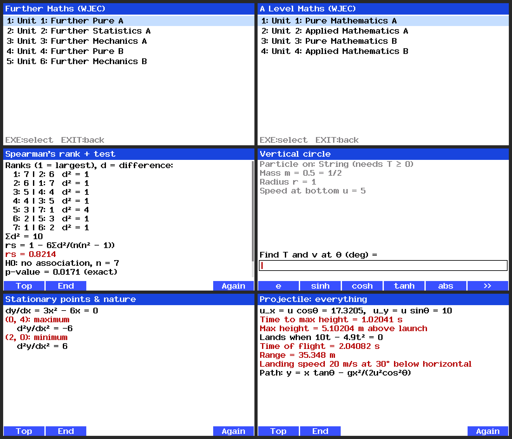
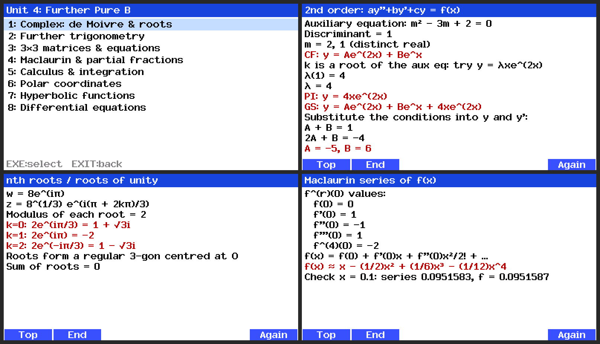
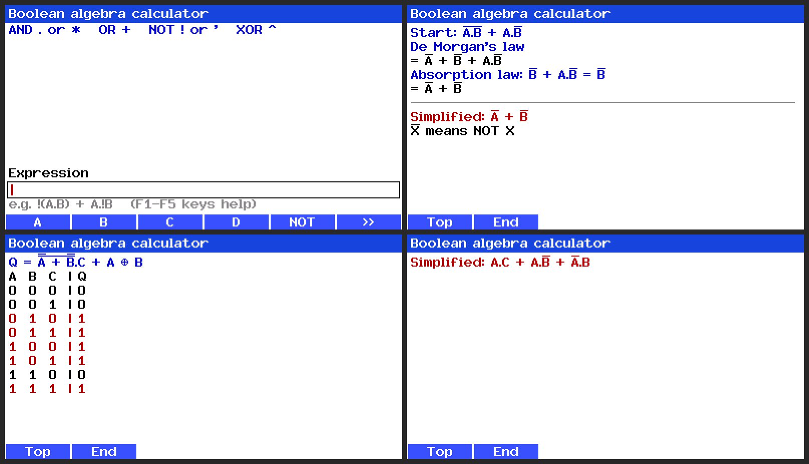
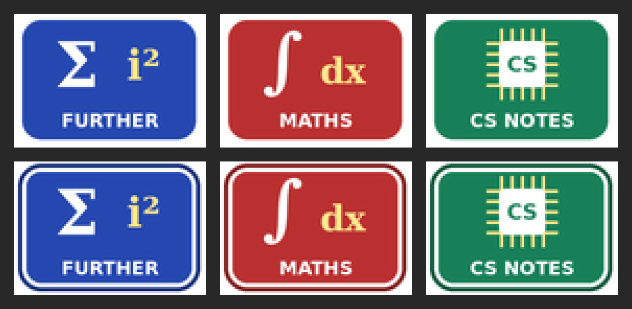

# CG50 WJEC Add-ins

Three native add-ins (`.g3a`) for the **Casio fx-CG50** graphing calculator, written in C:

| App | What it does |
|---|---|
| **Further Maths** | Calculators with full working for WJEC A Level Further Maths Units 1, 2, 3, 4 and 6 |
| **A Level Maths** | Calculators with full working for WJEC A Level Maths Units 1 to 4 |
| **CS Notes** | Revision notes for WJEC A Level Computer Science Units 1 to 4, plus a Boolean algebra calculator |



> **Revision tool only.** These add-ins are disabled when the calculator is in Exam Mode and must not be used in exams. JCQ rules ban calculators that give access to stored text or formulae, or that do symbolic differentiation or algebra. Put the calculator into Exam Mode (or remove the add-ins) before any exam.

## Built with Claude

I designed and built this project with **Claude (Anthropic's AI)** as an AI-assisted project. I set the requirements (which units, how each menu and screen should behave, what the output should look like), tested it and steered the design. Claude wrote most of the code. I've included this so it's clear how the project was made.

## Features

### Further Maths and A Level Maths
- Navigate by **Unit → Topic → Question type**, enter the inputs, and get the answer **with the working**, not just a number.
- About 150 calculators, including complex numbers and loci, matrices and invariant lines, 3D vectors (lines, planes, distances), de Moivre, Maclaurin series, polar, hyperbolics, 2nd order and coupled differential equations, partial fractions, mechanics (collisions, circular motion, SHM, centres of mass), statistics (Poisson, chi-squared, PMCC and Spearman's tests), SUVAT, projectiles, the normal distribution and more.
- Answers are given in **exact form** where possible (fractions, surds, multiples of π, ln forms) alongside the decimal.
- **Symbolic differentiation** (chain, product and quotient rules), implicit and parametric differentiation, tangents and normals.



### CS Notes
- 171 revision notes across 34 topics, following the WJEC specification.
- **Boolean algebra calculator:** enter any expression, then choose a truth table, step-by-step working, or just the answer. The working names the law used at every step and uses A Level notation (overbars for NOT, ⊕ for XOR).
- Tested against **33 real past-paper questions** (WJEC Unit 3 2017 to 2025 plus the specimen paper, and AQA). Every answer matches the mark scheme. See `cs/test/`.



## How it works

- **Language:** C (C99) on the calculator. Python for the build-time tools.
- **Toolchain:** [gint](https://git.planet-casio.com/Lephenixnoir/gint) and [fxSDK](https://git.planet-casio.com/Lephenixnoir/fxsdk), an open-source SH4 cross-compiler and runtime for Casio calculators.
- **One codebase, three platforms:** a thin platform layer (`common/plat.h`) has three implementations:
  - `common/plat_gint.c`: the real calculator
  - `desk/plat_desk.c`: a PC build, used for automated tests and screenshots
  - `web/plat_web.c`: a WebAssembly build (Emscripten) that runs the apps in a browser (`web/preview.html`)
- **Core engine (`common/`):**
  - `expr.c`: expression parser, complex evaluation, truncated power-series arithmetic (for exact Maclaurin coefficients), symbolic differentiation with simplification and pretty-printing, numerical integration (adaptive Simpson and tanh-sinh), and root finding
  - `num.c`: complex arithmetic, number formatting, and exact-form recognition (e.g. 0.70710678 → √2/2, 1.0471976 → π/3)
  - `la.c`: determinants, inverses, Gaussian elimination, and polynomial roots (Durand-Kerner)
  - `stats.c`: normal, t, chi-squared, Poisson and binomial distributions, plus the exact Spearman distribution
  - `ui.c`: menus, the input editor, and the scrolling results viewer
- **Boolean engine (`cs/boolean.c`):** a recursive-descent parser, rule-based rewriting that applies one named law at a time, and Quine-McCluskey minimisation to guarantee the minimal form.
- **Custom font:** the stock font is ASCII only, so maths glyphs (√ π θ Σ ∫ ≤ ⊕ …) were drawn as pixel art and packed into spare character codes (`desk/mkfont.py`).
- **Notes:** written as plain text (`cs/notes*.txt`) and converted to C by `cs/gen.py`.

## Install on the calculator

1. Download the `.g3a` files from [`release/`](release/).
2. Connect the CG50 by USB and choose **USB Flash** (F1).
3. Copy the files onto the calculator's drive, then eject.
4. The apps appear on the main menu.



## Build from source

**Calculator** (needs fxSDK + gint installed, e.g. via GiteaPC):
```sh
cd cg/fm && fxsdk build-cg      # also cg/maths, cg/cs
```

**PC test build and Boolean past-paper tests:**
```sh
make          # builds desk/fm, desk/maths, desk/cs
make test     # runs the 33 past-paper Boolean questions
```

**Browser version** (needs Emscripten):
```sh
web/build_web.sh
```

## Notes
- The CS notes were written from the WJEC specification headings. They aren't WJEC's official wording, so check anything important against your course materials.
- Not affiliated with Casio or WJEC.
